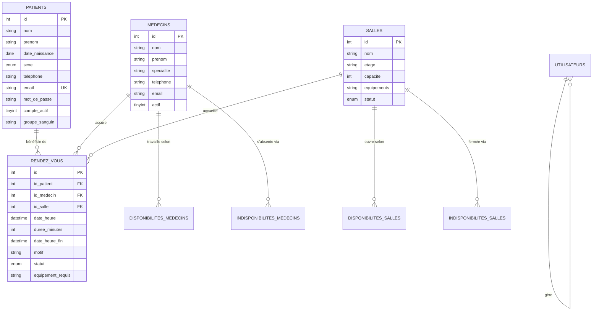

# Guide Technique & Pédagogique Complet — CENTRE MÉDICAL HOPE UCC
> **Note sur la version actuelle :** ce guide décrit l'ancienne version PHP/MySQL. Le projet exécutable est maintenant un site statique de démonstration, sans serveur PHP ni base de données. Pour le démarrer et connaître les limites du mode démo, consultez [README.md](./README.md). Le contenu ci-dessous est conservé comme documentation historique.

> **Système de Gestion des Rendez-vous Médicaux & Portail Patient**  
> **Université Catholique du Congo (UCC)** — Faculté des Sciences Informatiques  
> *Cours : Programmation Web II & Projet Orienté Objet*  
> *Technologies : PHP 8 (PDO / MySQL), HTML5 sémantique, CSS3 moderne (Flexbox / Grid), JavaScript Vanilla (ES6+)*

---

## Sommaire Général

1. [Architecture Globale & Fonctionnement du Projet](#1-architecture-globale--fonctionnement-du-projet)
2. [Structure de la Base de Données Relationnelle](#2-structure-de-la-base-de-données-relationnelle)
3. [Guide Détaillé des Balises HTML Utilisées](#3-guide-détaillé-des-balises-html-utilisées)
4. [Guide Détaillé de Chaque Propriété CSS Utilisée](#4-guide-détaillé-de-chaque-propriété-css-utilisée)
5. [Guide Détaillé de Toutes les Fonctions & Mécanismes PHP](#5-guide-détaillé-de-toutes-les-fonctions--mécanismes-php)
6. [Guide Détaillé du JavaScript (Interactivité & DOM)](#6-guide-détaillé-du-javascript-interactivité--dom)
7. [Système d'Envoi d'Emails & Sockets SMTP Directes](#7-système-denvoi-demails--sockets-smtp-directes)
8. [Fiche Médicale Imprimable & Optimisations `@media print`](#8-fiche-médicale-imprimable--optimisations-media-print)
9. [Tutoriel Pratique : Comment Modifier le Code Facilement](#9-tutoriel-pratique--comment-modifier-le-code-facilement)

---

## 1. Architecture Globale & Fonctionnement du Projet

### 1.1 Philosophie du projet
Le projet est conçu en **PHP procédural moderne** et **structuré**, sans framework lourd (pas de Laravel, Symfony ou React). Cela permet à un étudiant ou débutant de comprendre le flux exact de chaque requête HTTP, de la base de données jusqu'à l'écran de l'utilisateur.

```
                      [ Navigateur Client ]
                                |
             +------------------+------------------+
             |                                     |
   (Visiteur / Patient)                   (Personnel Médical)
             |                                     |
    index.php (Accueil)                  auth/login.php (Espace Pro)
    patients/inscription.php                       |
    patients/connexion.php               medecins/ (Gestion médecins)
             |                           patients/ (Dossiers cliniques)
    patients/espace.php (Dashboard)      salles/ (Salles & équipements)
    rendez_vous/prendre.php (Réservation) disponibilites/ (Plannings)
             |                           statistiques/ (Rapports)
             v                                     |
  [ verifierDisponibiliteRdv() ] <-----------------+
             |
   (Transactions ACID + FOR UPDATE)
             |
             +---------> rendez_vous/fiche.php (Billet A4 + QR Code)
             +---------> includes/mailer.php (Email HTML vers Gmail)
```

### 1.2 Rôles & Séparation des Espaces
1. **Espace Public** : Tout internaute peut consulter la page d'accueil ([index.php](file:///c:/Users/MUKSOFT/Music/gestion-rendez-vous-medicaux/index.php)), le carrousel de sensibilisation aux maladies (Ébola, Cancer du sein, Paludisme, Diabète), l'histoire de la clinique et les services.
2. **Espace Patient Dédié** :
   - Création de compte ([patients/inscription.php](file:///c:/Users/MUKSOFT/Music/gestion-rendez-vous-medicaux/patients/inscription.php)).
   - Connexion ([patients/connexion.php](file:///c:/Users/MUKSOFT/Music/gestion-rendez-vous-medicaux/patients/connexion.php)).
   - Session isolée : `$_SESSION['patient_id']`.
   - Prise de rendez-vous verrouillée à son propre dossier ([rendez_vous/prendre.php](file:///c:/Users/MUKSOFT/Music/gestion-rendez-vous-medicaux/rendez_vous/prendre.php)).
   - Suivi, impression des fiches et annulation ([patients/espace.php](file:///c:/Users/MUKSOFT/Music/gestion-rendez-vous-medicaux/patients/espace.php)).
3. **Espace Staff (Administration & Réception)** :
   - Connexion sécurisée ([auth/login.php](file:///c:/Users/MUKSOFT/Music/gestion-rendez-vous-medicaux/auth/login.php)).
   - Session staff : `$_SESSION['utilisateur_id']`, rôles `admin` ou `receptionniste`.
   - Accès protégé par la fonction `requireLogin()` sur tous les modules de gestion clinique.

### 1.3 Arborescence des Dossiers
```
gestion-rendez-vous-medicaux/
├── assets/
│   ├── css/
│   │   └── style.css            # Feuille de style globale (Design Centre Médical Hope)
│   ├── js/
│   │   └── script.js            # Interactivité (Menu, Carrousel, 3D, Calcul fin)
│   └── images/                  # Illustrations SVG et photos des médecins
├── auth/
│   ├── login.php                # Connexion du personnel médical
│   └── logout.php               # Déconnexion du personnel
├── config/
│   ├── database.php             # Connexion PDO, Sécurité, Moteur de règles RDV
│   └── email_config.php         # Paramètres SMTP (Gmail, ports, identifiants)
├── database/
│   └── gestion_rendez_vous.sql  # Script de création des tables et données de test
├── disponibilites/
│   └── index.php                # Gestion des créneaux et indisponibilités
├── emails_envoyes/
│   ├── index.php                # Journal et prévisualisation des emails HTML
│   └── *.html                   # Copies conformes des emails expédiés
├── includes/
│   ├── header.php               # En-tête HTML, Sidebar dynamique et Topbar
│   ├── footer.php               # Pied de page et inclusion JS avec cache-busting
│   ├── mailer.php               # Générateur d'email HTML de confirmation
│   └── smtp_client.php          # Client socket SMTP natif (chiffrement TLS)
├── index.php                    # Page d'accueil publique
├── medecins/                    # CRUD des médecins spécialistes
├── patients/
│   ├── inscription.php          # Création de compte patient
│   ├── connexion.php            # Connexion patient
│   ├── deconnexion.php          # Déconnexion patient
│   ├── espace.php               # Tableau de bord patient
│   └── index.php, ajouter.php...# Gestion staff des dossiers patients
├── rendez_vous/
│   ├── prendre.php              # Formulaire de réservation intelligente
│   ├── fiche.php                # Billet de rendez-vous imprimable (A4 + QR Code)
│   ├── index.php                # Liste et gestion des réservations
│   └── modifier.php, changer_statut.php
├── salles/                      # CRUD des salles de consultation
├── statistiques/                # Tableaux de bord et métriques de la clinique
└── tests/                       # Suite de tests de validation (7 tests TP + portail)
```

---

## 2. Structure de la Base de Données Relationnelle

Le schéma SQL repose sur **9 tables interconnectées** garantissant l'intégrité référentielle grâce au moteur **InnoDB** de MySQL / MariaDB :



---

## 3. Guide Détaillé des Balises HTML Utilisées

Chaque page du site utilise des balises HTML5 sémantiques. Voici la signification et l'utilité exacte de chacune :

### 3.1 Balises de Structure & Sémantique
| Balise HTML | Rôle & Utilité dans le projet | Exemple concret dans le code |
|---|---|---|
| `<!DOCTYPE html>` | Déclare au navigateur que le document est en HTML5 standard. | Première ligne de [header.php](file:///c:/Users/MUKSOFT/Music/gestion-rendez-vous-medicaux/includes/header.php). |
| `<html lang="fr">` | Racine du document avec spécification de la langue française pour les moteurs et lecteurs d'écran. | Début de page. |
| `<head>` | Contient les métadonnées (titre, encodage, feuilles de style CSS, fontes Google) non affichées directement. | Bloc haut de `header.php`. |
| `<meta charset="UTF-8">` | Définit l'encodage des caractères en UTF-8 (support parfait des accents é, è, ê, à). | Dans `<head>`. |
| `<meta name="viewport" content="...">` | **Essentiel pour le Responsive** : indique aux mobiles d'adapter la largeur à l'écran (`width=device-width`). | Dans `<head>`. |
| `<title>` | Définit le texte affiché dans l'onglet du navigateur et dans les favoris. | `<title><?= e($pageTitle) ?> — Centre Médical Hope</title>` |
| `<link rel="stylesheet">` | Relie la page web à la feuille de style CSS externe. | `<link rel="stylesheet" href="assets/css/style.css">` |
| `<body class="app-body">` | Contient tout le contenu visible de la page. | [header.php](file:///c:/Users/MUKSOFT/Music/gestion-rendez-vous-medicaux/includes/header.php) ligne 60. |
| `<aside class="app-sidebar">` | Représente la barre latérale gauche (Sidebar) contenant le menu du dashboard. | Sidebar de navigation. |
| `<header class="app-topbar">` | En-tête supérieur de la page contenant le titre de section, les boutons d'actions et l'avatar utilisateur. | Haut du dashboard. |
| `<nav class="sidebar-nav">` | Délimite la zone réservée aux liens de navigation. | Dans la sidebar. |
| `<main class="app-content">` | Balise sémantique désignant le cœur du contenu de la page courante. | Conteneur des pages. |
| `<section>` | Isole une section thématique indépendante (ex: Carrousel, Services, Histoire). | Sections de [index.php](file:///c:/Users/MUKSOFT/Music/gestion-rendez-vous-medicaux/index.php). |
| `<footer class="app-footer">` | Pied de page contenant les mentions légales, copyright et liens d'accès rapide. | [footer.php](file:///c:/Users/MUKSOFT/Music/gestion-rendez-vous-medicaux/includes/footer.php). |
| `<div>` | Conteneur générique de division en bloc (utilisé pour grouper et styliser via CSS Grid ou Flexbox). | Partout dans le projet. |
| `<span>` | Conteneur générique en ligne (utilisé pour styliser un petit mot, badge ou icône sans retour à la ligne). | `<span class="badge">Confirmé</span>` |
| `<h1>`, `<h2>`, `<h3>`... | Titres hiérarchiques du document (H1 = titre majeur unique, H2 = sous-titre de section, etc.). | Titres de bannières et de cartes. |
| `<p>` | Paragraphe de texte avec espacement naturel haut/bas. | Textes descriptifs. |
| `<ul>` et `<li>` | Liste non ordonnée (`<ul>`) et éléments de liste (`<li>`) pour les menus et listes d'équipements. | Menu de la sidebar. |
| `<strong>` | Met un texte en gras avec une valeur sémantique d'importance forte. | Noms des médecins, heures clés. |

---

### 3.2 Balises de Formulaires & Données Utilisateur
| Balise / Type | Rôle technique | Particularité dans Centre Médical Hope |
|---|---|---|
| `<form method="POST">` | Délimite un formulaire. La méthode `POST` transmet les données de manière invisible et sécurisée dans le corps de la requête. | Utilisé pour la connexion, inscription, prise de RDV. |
| `<input type="hidden">` | Champ invisible à l'utilisateur. | Stocke le jeton anti-CSRF (`csrf_token`) et les identifiants techniques. |
| `<input type="text">` | Saisie d'une ligne de texte classique. | Prénom, Nom, Motif de consultation. |
| `<input type="email">` | Valide automatiquement le format d'une adresse email (présence du `@` et du domaine). | Champ email de connexion. |
| `<input type="password">` | Masque les caractères saisis par des puces pour protéger le mot de passe des regards. | Mots de passe d'authentification. |
| `<input type="tel">` | Clavier optimisé pour les numéros de téléphone sur smartphone. | Téléphone du patient. |
| `<input type="date">` | Sélecteur de date natif avec calendrier déroulant. | Date de naissance du patient. |
| `<input type="datetime-local">` | Sélecteur combiné de Date et d'Heure (format `YYYY-MM-DDTHH:MM`). | Sélection du créneau de consultation. |
| `<select>` & `<option>` | Liste déroulante permettant de choisir une option parmi une liste. | Choix du médecin, de la salle, de la durée (15, 30, 45 min). |
| `<textarea>` | Zone de texte multiligne pour saisir de longs commentaires. | Remarques médicales, antécédents. |
| `<label for="...">` | Libellé associé à un champ. Cliquer sur le label donne le focus au champ correspondant grâce à son `id`. | Améliore l'ergonomie et l'accessibilité. |
| `<button type="submit">` | Déclenche l'envoi du formulaire au serveur PHP. | Boutons de confirmation. |

---

### 3.3 Balises SVG Vectorielles (Graphismes Haute Définition)
Le projet remplace les images pixelisées par des graphismes vectoriels SVG purs, légers et nets quelle que soit la résolution d'écran :
- `<svg viewBox="0 0 24 24">` : Définit la boîte englobante et le système de coordonnées vectorielles.
- `<path d="...">` : Trace des courbes et formes complexes (stéthoscope, bouclier, cœur, électrocardiogramme).
- `<circle cx="..." cy="..." r="...">` : Dessine des cercles parfaits (pastilles d'état, boutons de carrousel).
- `<rect x="..." y="..." width="..." height="..." rx="...">` : Dessine des rectangles aux coins arrondis (`rx`).
- `<linearGradient>` & `<stop>` : Génère des dégradés de couleurs fluides (du vert foncé au vert émeraude).

---

## 4. Guide Détaillé de Chaque Propriété CSS Utilisée

Le fichier [assets/css/style.css](file:///c:/Users/MUKSOFT/Music/gestion-rendez-vous-medicaux/assets/css/style.css) implémente un design system médical épuré. Voici l'explication détaillée de chaque famille de propriétés CSS.

### 4.1 Variables CSS (`:root`)
```css
:root {
  --teal-500: #0f764a; /* Vert médical principal */
  --page-bg:  #f2f8f5; /* Fond de page vert très doux */
}
```
- **Définition** : Déclare des variables globales réutilisables dans tout le fichier.
- **Avantage débutant** : Si vous souhaitez changer la couleur verte du site pour une autre nuance, il vous suffit de modifier `--teal-500` à la ligne 28 de `style.css`, et **tout le site** s'actualise instantanément !

---

### 4.2 Le Modèle de Boîte (Box Model)
```css
*, *::before, *::after {
  box-sizing: border-box;
  margin: 0;
  padding: 0;
}
```
- `box-sizing: border-box;` : **Règle fondamentale du Web moderne**. Indique au navigateur que les bordures (`border`) et marges intérieures (`padding`) sont incluses dans la largeur (`width`) de l'élément, évitant que les boîtes ne dépassent de l'écran.
- `margin` : Espace extérieur libre autour d'un élément (repousse les voisins).
- `padding` : Espace intérieur d'aération entre le contenu d'une boîte et sa bordure.
- `border` : Trait de bordure entourant l'élément (ex: `1px solid #d1fae5`).
- `border-radius` : Arrondit les angles d'une boîte (ex: `10px`, ou `9999px` pour une pilule parfaitement ronde).

---

### 4.3 Flexbox (`display: flex;`) — Mise en page unidimensionnelle
Flexbox est utilisé pour aligner horizontalement ou verticalement les éléments dans les cartes, la sidebar et la barre supérieure :
- `display: flex;` : Transforme le conteneur en boîte flexible.
- `flex-direction: row | column;` : Dispose les enfants en ligne (horizontal) ou en colonne (vertical).
- `justify-content: space-between;` : Répartit les enfants avec un espace maximal entre eux (le premier tout à gauche, le dernier tout à droite).
- `justify-content: center;` : Centre horizontalement les éléments.
- `align-items: center;` : Centre verticalement tous les enfants sur la même ligne.
- `flex-wrap: wrap;` : Permet aux éléments de passer automatiquement à la ligne suivante si l'écran est trop étroit (sur mobile).
- `gap: 16px;` : Crée un espacement net et régulier entre tous les enfants sans avoir à jongler avec des marges manuelles.

---

### 4.4 CSS Grid (`display: grid;`) — Mise en page bidimensionnelle
CSS Grid est utilisé pour la grille des médecins, des salles et les formulaires à colonnes multiples :
```css
.whatsapp-doctors-grid {
  display: grid;
  grid-template-columns: repeat(auto-fit, minmax(280px, 1fr));
  gap: 20px;
}
```
- `display: grid;` : Active le moteur de grille bidimensionnel (lignes et colonnes).
- `grid-template-columns: repeat(auto-fit, minmax(280px, 1fr));` : **Mise en page auto-adaptative magique**. La grille crée automatiquement autant de colonnes que possible ayant au moins `280px` de large, et les étire à parts égales (`1fr`). Sur grand écran : 4 colonnes, sur tablette : 2 colonnes, sur mobile : 1 colonne automatique **sans aucune media query** !

---

### 4.5 Positionnement & Superposition
- `position: relative;` : Positionne l'élément normalement mais sert de repère de référence pour ses enfants absolus.
- `position: absolute;` : Retire l'élément du flux normal et le place précisément par rapport à son parent relatif (ex: pastille de notification rouge sur la cloche).
- `position: fixed;` : Fige un élément à l'écran (ex: barre de navigation mobile qui reste visible pendant le défilement).
- `position: sticky; top: 90px;` : L'élément défile avec la page jusqu'à atteindre `90px` du haut, puis reste collé (utilisé pour la carte profil patient à droite).
- `z-index: 1000;` : Gère l'ordre d'empilement (plus le chiffre est élevé, plus l'élément est au premier plan, devant les autres).

---

### 4.6 Effets Visuels, Ombres & Transitions
- `box-shadow: 0 4px 14px rgba(0,0,0,0.08);` : Projette une ombre douce donnant du relief (élévation 3D).
- `background: linear-gradient(135deg, #052e16 0%, #064e3b 100%);` : Dégradé de couleur en diagonale (135°).
- `transition: all 0.22s ease;` : Anime de façon fluide toute modification d'état (ex: au survol d'un bouton).
- `transform: translateY(-2px);` : Soulève légèrement le bouton de 2 pixels vers le haut au survol de la souris.
- `opacity: 0.8;` : Définit la transparence d'un élément (de 0.0 invisible à 1.0 opaque).

---

### 4.7 Responsive Web Design (`@media`)
```css
@media (max-width: 1024px) {
  .app-sidebar {
    transform: translateX(-100%); /* Masque la sidebar hors de l'écran */
  }
  .app-sidebar.open {
    transform: translateX(0); /* Fait glisser la sidebar à l'écran */
  }
}
```
Les règles `@media` appliquent des styles spécifiques lorsque la largeur de l'écran passe sous un certain seuil (ex: smartphones et tablettes sous `1024px`).

---

## 5. Guide Détaillé de Toutes les Fonctions & Mécanismes PHP

### 5.1 Fonctions de Sécurité & Session ([config/database.php](file:///c:/Users/MUKSOFT/Music/gestion-rendez-vous-medicaux/config/database.php))

#### `getDBConnection()`
- **Rôle** : Initialise et renvoie l'objet PDO unique pour communiquer avec MySQL (Pattern Singleton statique).
- **Options PDO cruciales** :
  - `PDO::ATTR_ERRMODE => PDO::ERRMODE_EXCEPTION` : Déclenche une exception dès qu'une requête SQL échoue (évite les erreurs silencieuses).
  - `PDO::ATTR_DEFAULT_FETCH_MODE => PDO::FETCH_ASSOC` : Les résultats SQL sont retournés sous forme de tableaux associatifs lisibles (`$patient['nom']`).
  - `PDO::ATTR_EMULATE_PREPARES => false` : Force MySQL à utiliser de **vraies requêtes préparées**, empêchant 100% des injections SQL.

#### `e($string)` — Protection XSS
```php
function e($string) {
    return htmlspecialchars($string ?? '', ENT_QUOTES, 'UTF-8');
}
```
- **Rôle** : Échappe les caractères spéciaux (`<`, `>`, `"`, `'`, `&`) en entités HTML (`&lt;`, `&gt;`).
- **Pourquoi c'est vital** : Si un patient saisit `<script>alert('hack')</script>` dans son nom, `e()` transforme la chaîne en texte inoffensif.

#### `generateCsrfToken()` & `verifyCsrfToken($token)` — Protection CSRF
- **Rôle** : Protège les formulaires contre la falsification de requêtes inter-sites (CSRF).
- **Fonctionnement** :
  1. `generateCsrfToken()` génère 32 octets aléatoires cryptographiques (`random_bytes(32)`) convertis en hexadécimal et les stocke dans `$_SESSION['csrf_token']`.
  2. Chaque formulaire inclut `<input type="hidden" name="csrf_token" value="<?= generateCsrfToken() ?>">`.
  3. À la soumission, `verifyCsrfToken()` compare le jeton reçu avec celui en session via `hash_equals()` (résistant aux attaques temporelles).

#### `isLoggedIn()` / `requireLogin()` (Personnel Staff) vs `isPatientLoggedIn()` / `requirePatientLogin()` (Patients)
- **Isolation des sessions** :
  - Le personnel staff utilise : `$_SESSION['utilisateur_id']` et `$_SESSION['utilisateur_role']`.
  - Le patient utilise : `$_SESSION['patient_id']`, `$_SESSION['patient_nom']`.
- **Bénéfice** : Un patient ne peut jamais se faire passer pour un administrateur, car leurs identifiants de session sont dans des compartiments totalement étanches !

#### `flashMessage($type, $message)` & `getFlashMessages()`
- **Rôle** : Affiche un message d'information ou de succès sur la page suivante (après une redirection HTTP `header('Location: ...')`).
- **Mécanisme** : Le message est déposé en session, puis lu et immédiatement effacé (`unset`) lors du chargement de la page suivante.

---

### 5.2 Le Moteur Central de Règles : `verifierDisponibiliteRdv()`
Situé à la ligne 160 de [config/database.php](file:///c:/Users/MUKSOFT/Music/gestion-rendez-vous-medicaux/config/database.php), ce moteur valide l'ensemble des contraintes médicales avant d'enregistrer une réservation.

#### La Formule Mathématique de Chevauchement Temporel
Pour savoir si un nouveau créneau `[Debut_A, Fin_A]` entre en collision avec un créneau existant `[Debut_B, Fin_B]`, la condition SQL universelle et infaillible est :
$$\text{Chevauchement} \iff (\text{Debut}_A < \text{Fin}_B) \;\text{ET}\; (\text{Fin}_A > \text{Debut}_B)$$

```sql
SELECT r.* FROM rendez_vous r
WHERE r.id_medecin = ?
  AND r.statut NOT IN ('annule')
  AND ? < r.date_heure_fin AND ? > r.date_heure
```
Cette formule détecte absolument tous les cas :
1. Début à l'intérieur d'un RDV existant.
2. Fin à l'intérieur d'un RDV existant.
3. Nouveau RDV qui englobe totalement un RDV plus court.
4. Chevauchement parfait à la minute près.

#### Les 6 Règles Vérifiées dans l'Ordre :
1. **Règle 1 : Patient existant** : Vérifie dans la table `patients` que l'identifiant est valide.
2. **Règle 2.1 : Horaires du médecin** : Vérifie dans `disponibilites_medecins` que le médecin consulte bien ce jour-là (Lundi à Samedi) et sur toute la plage demandée.
3. **Règle 2.2 : Congés et absences** : Vérifie dans `indisponibilites_medecins` que le praticien n'est ni en congé, ni en réunion, ni malade.
4. **Règle 2.3 : Agenda du médecin** : Vérifie l'absence de chevauchement avec un autre patient.
5. **Règle 3.1 & 3.2 : Disponibilité de la salle** : Vérifie que la salle est ouverte et n'est pas en maintenance ou désinfection.
6. **Règle 3.3 & 3.4 : Équipements & Occupation salle** : Vérifie qu'aucun autre médecin n'utilise cette salle au même moment et que les équipements requis (ex: ECG, Échographe) y sont présents.

---

### 5.3 Transactions SQL ACID & Verrouillage Pessimiste (`FOR UPDATE`)
Dans [rendez_vous/prendre.php](file:///c:/Users/MUKSOFT/Music/gestion-rendez-vous-medicaux/rendez_vous/prendre.php) (lignes 90-135) :
```php
$pdo->beginTransaction(); // Début transaction

// Verrouillage exclusif : aucune autre requête ne peut lire/écrire sur ce médecin
$stmtLockMed = $pdo->prepare("SELECT id FROM medecins WHERE id = ? FOR UPDATE");
$stmtLockMed->execute([$id_medecin]);

$verif = verifierDisponibiliteRdv(...);
if ($verif['valide']) {
    // Insertion du rendez-vous
    $pdo->commit(); // Tout est validé définitivement
} else {
    $pdo->rollBack(); // Annulation complète, la base reste intacte
}
```
- **Pourquoi c'est important** : Si deux patients cliquent en même temps sur le même créneau, le premier pose un verrou `FOR UPDATE`. Le second attend quelques millisecondes et se voit refuser le créneau dès que le premier a validé. **Zéro risque de doublon !**

---

## 6. Guide Détaillé du JavaScript (Interactivité & DOM)

Le fichier [assets/js/script.js](file:///c:/Users/MUKSOFT/Music/gestion-rendez-vous-medicaux/assets/js/script.js) contient le code JavaScript exécuté côté navigateur.

### 6.1 Écouteur de Chargement Initial
```javascript
document.addEventListener('DOMContentLoaded', function () { ... });
```
- Attends que l'ensemble du HTML soit téléchargé et analysé par le navigateur avant d'exécuter le script, évitant les erreurs `Cannot read property of null`.

### 6.2 Menu Mobile & Sidebar (Toggle)
- `topbarMenuToggle.addEventListener('click', ...)` : Écoute le clic sur l'icône burger.
- `appSidebar.classList.add('open')` : Ajoute la classe CSS `.open` qui applique la translation `transform: translateX(0)` pour faire glisser le menu.
- `sidebarBackdrop.addEventListener('click', closeSidebar)` : Ferme le menu dès que l'utilisateur clique sur le voile sombre en dehors de la sidebar.

### 6.3 Calcul Dynamique de l'Heure de Fin de Rendez-vous
```javascript
function actualiserApercuFin() {
    const valDate = inputDateHeure.value; // Ex: "2026-11-10T09:00"
    const duree = parseInt(selectDuree.value, 10); // Ex: 30

    const dateObj = new Date(valDate);
    dateObj.setMinutes(dateObj.getMinutes() + duree); // Ajoute la durée

    const heures = String(dateObj.getHours()).padStart(2, '0');
    const minutes = String(dateObj.getMinutes()).padStart(2, '0');
    displayFin.textContent = `⏰ Fin estimée : ${heures}h${minutes}`;
}
```
- `new Date(valDate)` : Transforme la chaîne en objet Date JavaScript manipulable.
- `dateObj.setMinutes(...)` : Calcule automatiquement le dépassement d'heure (ex: 09h45 + 30 min devient automatiquement 10h15).
- `padStart(2, '0')` : Ajoute un zéro devant si le chiffre est inférieur à 10 (`09` au lieu de `9`).

### 6.4 Carrousel Automatique de Sensibilisation
- `setInterval(() => { updateCarousel(currentIndex + 1); }, 6500);` : Déclenche automatiquement le passage à la diapositive suivante toutes les 6,5 secondes.
- `carouselTrack.style.transform = 'translateX(-' + (currentIndex * 100) + '%)'` : Déplace horizontalement le ruban de diapositives de 100% de la largeur.
- `touchstart` et `touchend` : Mesure la différence de position horizontale du doigt du patient (`diffX`) pour permettre de glisser les diapositives au doigt sur smartphone (Swipe tactile).

---

## 7. Système d'Envoi d'Emails & Sockets SMTP Directes

### 7.1 Architecture d'Expédition ([includes/smtp_client.php](file:///c:/Users/MUKSOFT/Music/gestion-rendez-vous-medicaux/includes/smtp_client.php))
Contrairement à beaucoup de tutoriels qui nécessitent d'installer des bibliothèques externes, ce projet intègre un **client SMTP autonome en pur PHP** via les flux de sockets réseaux (`stream_socket_client`) :

```
[ Application PHP Centre Médical Hope ]
             |
   (Connexion Socket TLS Port 587 / 465)
             |
             v
     [ smtp.gmail.com ]
             |
      1. EHLO localhost
      2. STARTTLS (Chiffrement sécurisé des échanges)
      3. AUTH LOGIN (Transmission sécurisée base64 du compte & mot de passe d'application)
      4. MAIL FROM: <audreykasala880@gmail.com>
      5. RCPT TO: <patient@gmail.com>
      6. DATA (Transmission des en-têtes MIME HTML UTF-8 et du message)
      7. QUIT
             |
             v
 [ Boîte de réception Gmail du Patient ]
```

### 7.2 Configuration ([config/email_config.php](file:///c:/Users/MUKSOFT/Music/gestion-rendez-vous-medicaux/config/email_config.php))
- `SMTP_ACTIF` : `true` pour envoyer en direct sur Internet via Gmail, ou `false` pour fonctionner en mode simulation locale.
- `SMTP_USER` : L'adresse Gmail de la clinique qui expédie les confirmations.
- `SMTP_PASS` : Le mot de passe d'application généré sur Google Sécurité (16 lettres).
- **Archivage systématique** : Même en cas de coupure Internet, une copie exacte de l'email HTML est sauvegardée dans le dossier `emails_envoyes/` pour ne jamais perdre une notification !

---

## 8. Fiche Médicale Imprimable & Optimisations `@media print`

La page [rendez_vous/fiche.php](file:///c:/Users/MUKSOFT/Music/gestion-rendez-vous-medicaux/rendez_vous/fiche.php) produit un reçu officiel de consultation médicale au format A4.

### 8.1 Éléments Clés de la Fiche
1. **En-tête officiel** : Logo vectoriel Centre Médical Hope, intitulé de la clinique, coordonnées.
2. **Référence Billet** : Identifiant codé (ex: `RDV-2026-00060`).
3. **Double bloc patient & praticien** : Toutes les coordonnées et antécédents utiles.
4. **Grand bandeau horaire** : Date, heure et durée de consultation.
5. **QR Code vectoriel SVG** : Généré en coordonnées matricielles pures, lisible par n'importe quel lecteur de QR Code ou caméra de smartphone pour valider le billet à l'accueil.
6. **Cadres de signatures** : Cachet de réception et signature du praticien.

### 8.2 La Règle d'Impression CSS (`@media print`)
Pour que l'impression soit parfaite sans que l'utilisateur n'ait à régler son imprimante :
```css
@media print {
  /* Masque toute l'interface du site */
  .app-sidebar, .app-topbar, .app-footer, .no-print, .alert {
    display: none !important;
  }
  
  /* Supprime les marges et force le fond blanc */
  body, .printable-fiche {
    background: #ffffff !important;
    box-shadow: none !important;
    border: none !important;
    padding: 0 !important;
  }

  /* Force l'impression des couleurs d'en-tête */
  .fiche-horaire-banner {
    -webkit-print-color-adjust: exact !important;
    print-color-adjust: exact !important;
  }

  @page {
    size: A4 portrait;
    margin: 8mm; /* Marges régulières de 8mm sur toute la feuille */
  }
}
```
L'utilisateur clique sur le bouton **« Imprimer la fiche (PDF) »**, et le navigateur ouvre la boîte de dialogue d'impression prête à être imprimée ou enregistrée en PDF d'une seule page !

---

## 9. Tutoriel Pratique : Comment Modifier le Code Facilement

### Cas 1 : Changer la couleur verte principale du site
1. Ouvrez le fichier [assets/css/style.css](file:///c:/Users/MUKSOFT/Music/gestion-rendez-vous-medicaux/assets/css/style.css).
2. Aux lignes 26 à 32, modifiez la valeur hexadécimale de `--teal-500` (ex: remplacez `#0f764a` par `#0284c7` pour passer en bleu, ou `#059669` pour un vert menthe).
3. Sauvegardez : toutes les pages changent de couleur instantanément.

### Cas 2 : Ajouter une nouvelle spécialité médicale
1. Ouvrez la base de données dans phpMyAdmin (`http://localhost/phpmyadmin`).
2. Allez sur la table `medecins`.
3. Cliquez sur l'onglet **Structure**, puis modifiez la colonne `specialite` pour ajouter votre spécialité, ou tapez-la directement dans le formulaire d'ajout d'un médecin ([medecins/ajouter.php](file:///c:/Users/MUKSOFT/Music/gestion-rendez-vous-medicaux/medecins/ajouter.php)).

### Cas 3 : Ajouter une durée de consultation (ex: 120 minutes)
1. Ouvrez [rendez_vous/prendre.php](file:///c:/Users/MUKSOFT/Music/gestion-rendez-vous-medicaux/rendez_vous/prendre.php).
2. À la ligne 58, ajoutez `120` dans la vérification PHP :
   ```php
   if (!in_array($duree_minutes, [15, 30, 45, 60, 90, 120])) $duree_minutes = 30;
   ```
3. À la ligne 285 dans le formulaire HTML, ajoutez l'option :
   ```html
   <option value="120">120 minutes (Intervention chirurgicale)</option>
   ```

### Cas 4 : Créer une nouvelle page en respectant le template
Créez un nouveau fichier `mon_dossier/ma_page.php` :
```php
<?php
$pageTitle = "Titre de ma nouvelle page";
require_once __DIR__ . '/../config/database.php';

// Si la page est réservée au personnel médical :
// requireLogin();

// Si la page est réservée au patient :
// requirePatientLogin();

require_once __DIR__ . '/../includes/header.php';
?>

<div class="container" style="max-width: 1100px;">
    <div class="page-top-banner">
        <div class="page-banner-title">Ma Nouvelle Page</div>
    </div>

    <div class="card" style="background:#fff; padding:24px; border-radius:14px;">
        Contenu de votre page ici...
    </div>
</div>

<?php require_once __DIR__ . '/../includes/footer.php'; ?>
```

---

## 10. Conclusion & Bonnes Pratiques de Développement

Ce projet illustre l'ensemble des bonnes pratiques du génie logiciel web :
- **Sécurité à la conception (Security by Design)** : Requêtes préparées PDO contre les injections SQL, jetons CSRF contre les falsifications, hachage bcrypt pour les mots de passe et échappement `e()` contre les failles XSS.
- **Intégrité transactionnelle** : Transactions ACID et verrous exclusifs pour éviter tout conflit d'horaires.
- **Accessibilité & Ergonomie** : Structure HTML5 sémantique, design responsive sur mobile, tablette et ordinateur, retours visuels instantanés et fiches PDF imprimables.
- **Maintenabilité** : Code commenté en français, variables CSS centralisées et fonctions réutilisables.
